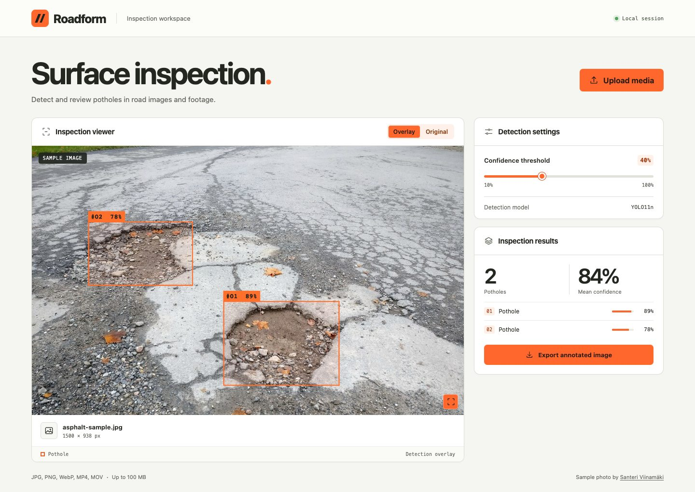

# Roadform

Roadform detects potholes in road photographs and recorded dashcam footage. It runs on your computer and opens in a browser, where you can review each detection, adjust the confidence threshold, and export annotated media.



## Quick start

Use Python 3.11. The trained model and sample photograph are included in the repository.

```sh
git clone https://github.com/samsonjayaraju/Roadform-.git
cd Roadform-
```

**macOS or Linux**

```sh
python3.11 -m venv .venv
.venv/bin/python -m pip install -r requirements.txt
.venv/bin/python app.py
```

**Windows PowerShell**

```powershell
py -3.11 -m venv .venv
.\.venv\Scripts\python.exe -m pip install -r requirements.txt
.\.venv\Scripts\python.exe app.py
```

Open [Roadform on localhost](http://127.0.0.1:8080). The server listens on the loopback interface and runs inference on the CPU. To use another port, set the `PORT` environment variable before starting the server.

## Try an inspection

The sample opens at 40% confidence with two potholes outlined. Raise the threshold to 85% and only the higher-confidence detection remains. Select **Original** to compare the markings with the road surface.

| Input | How to inspect it | Export |
| --- | --- | --- |
| JPEG, PNG, WebP | Select **Upload media**. Drag the confidence slider to filter the boxes and update the count and mean confidence. | Full-resolution annotated PNG |
| MP4, MOV | Upload a clip, set the threshold, and select **Analyze clip**. Changing the threshold lets you run the clip again. | Silent H.264 MP4 with per-frame annotations |

The upload limit is 100 MB per request. Images can contain up to 32 megapixels. Video counts include each appearance in each frame, so a pothole visible for ten frames can contribute ten detections.

## Tech stack

| Component | Technology | Role |
| --- | --- | --- |
| Local server | Python 3.11, Flask, Jinja | Serves the workspace and handles media uploads |
| Detection | Ultralytics YOLO11n, PyTorch | Runs the bundled pothole checkpoint on the CPU |
| Images and frames | Pillow, NumPy, OpenCV | Applies image orientation, prepares video frames, and draws clip annotations |
| Video processing | FFmpeg via imageio-ffmpeg | Decodes uploaded clips and encodes H.264 exports |
| Browser interface | HTML, CSS, JavaScript, Canvas API | Renders overlays, filters image detections, and exports annotated images |

The interface uses Apple's native system font on Apple devices and the system UI font on other platforms. The Python entry-point dependencies are pinned in [requirements.txt](requirements.txt).

## Project layout

```text
app.py                 Flask routes and inference pipeline
models/pothole.pt      Trained YOLO11n checkpoint
templates/index.html   Inspection workspace
static/style.css       Responsive layout, typography, and controls
static/workbench.js    Uploads, threshold filtering, previews, and exports
static/sample-road.jpg Sample road photograph
docs/                  Workspace preview
requirements.txt       Python dependencies
```

## Model and image credits

- Roadform uses Venu Madhav’s pretrained road-damage checkpoint. The app verifies its SHA-256 digest before loading and uses an inference image size of 800 pixels with a non-maximum suppression IoU threshold of 0.45. [Upstream model revision](https://github.com/VenuMadhav-IN18/road-damage-detection/blob/4c039d83c007797536b691f3d59ea9eeb2ebfb58/best.pt)
- The bundled sample and the road photograph in the workspace preview are cropped and resized from *Potholes on asphalt road 20171023* by Santeri Viinamäki. The preview adds detection annotations. The adapted photograph is available under CC BY-SA 4.0. [Original photograph](https://commons.wikimedia.org/wiki/File:Potholes_on_asphalt_road_20171023.jpg) · [License](https://creativecommons.org/licenses/by-sa/4.0/)
